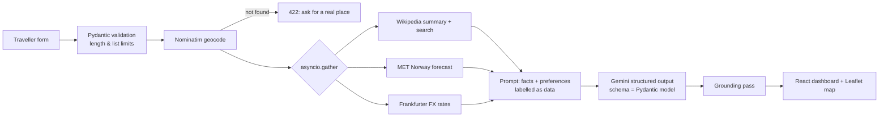

# CultureLens AI

> Discover destinations like a local, not a tourist.

CultureLens AI turns a destination and a traveller profile into a day-by-day itinerary with heritage sites, hidden gems, local food, etiquette, a phrasebook and an interactive map, plus a chat guide that knows your plan.

**Live:** [culturelens-ai-frontend.onrender.com](https://culturelens-ai-frontend.onrender.com) (free tier: the first request after idle can take ~1 minute while the API wakes up)

**Stack:** FastAPI · Pydantic · Google Gen AI SDK (Gemini) · httpx/asyncio · React · TypeScript · Vite · Leaflet · Tailwind · pytest · Vitest · GitHub Actions · Render

---

## How it works

The core idea is **retrieve, then generate, then ground**: the model writes the narrative, but facts come from real APIs and overwrite whatever the model says.



**What comes from where**

| Field | Source |
|---|---|
| Destination name, coordinates, country, currency code | Nominatim (overwrites model output) |
| Weather and forecast | MET Norway Locationforecast (overwrites model output) |
| Exchange rate | Frankfurter / ECB (stated as unavailable if missing, never defaulted) |
| Attraction pins | Generated by Gemini, then **dropped** if outside the destination's bounding box (min 50 km radius) |
| Itinerary, stories, food, etiquette, phrases | Generated by Gemini, constrained to the response schema |

---

## Engineering notes

This started as a **3.5-hour hackathon build** for Google PromptWars (4 July 2026), scaffolded from an earlier project. A later audit treated it like production code and found real problems. They're listed here because the fixes are the interesting part.

### What the audit found

| Area | Problem | Impact |
|---|---|---|
| Grounding | Failed geocoding silently fell back to **Tokyo** | A typo planned a trip to the wrong country |
| Grounding | Response weather was the **model's** text, not the fetched forecast | "Factual" data was hallucinated |
| Grounding | Unsupported currencies (AED, SAR, EGP…) reported as **1 USD = 1.0** | Confidently wrong budgets |
| Security | Model output injected into Leaflet popups as raw HTML | **XSS** via prompt injection |
| Security | No input limits, forgeable chat roles, CORS `*` with credentials, no rate limit | Prompt bloat, role injection, open Gemini bill |
| Security | Body-size check ran *after* FastAPI had parsed the body | The limit protected nothing |
| Dependencies | Starlette 0.37 (9 advisories), protobuf DoS, 19 dev-tool alerts | Runtime CVEs that Dependabot never reported (transitive deps) |
| Testing | `pytest` crashed on a scratch script; the suite only passed if a real API key was set | No CI, so none of this was caught |

### How it was fixed

- **Ground, don't trust.** Every field with a real source is overwritten after generation; missing facts are labelled *unavailable*; attractions are distance-checked with a haversine filter against the geocoder's bounding box (so "Japan" keeps country-wide sites and "Kyoto" stays local).
- **One schema.** The Pydantic `CultureLensResponse` model is passed directly to the Gen AI SDK as the structured-output schema. This replaced a 220-line hand-maintained copy that the legacy SDK required, which removes the risk of the two drifting apart.
- **Defence in depth against prompt injection.** No character filter can stop plain-English instructions, so it is handled structurally: user text is fenced and labelled as data, chat roles are an enum, and model output is never rendered as HTML (popups are DOM text nodes; links and images must be `https:`).
- **Abuse controls.** Per-field limits, a 256 KB body cap enforced in middleware before parsing, an explicit CORS allow-list, and per-IP rate limits on the two Gemini-backed endpoints.
- **Supply chain.** Upgraded to FastAPI 0.165 / Starlette 1.10, Vite 6, Vitest 5, and migrated from the legacy `google-generativeai` SDK to `google-genai`, which also removed protobuf and gRPC from the runtime. `pip-audit` and `npm audit` report zero known vulnerabilities.
- **Hermetic tests + CI.** 52 backend and 26 frontend tests run with no API key and no network (HTTP is mocked at the transport layer). GitHub Actions runs both suites and the production build on every push and PR.

### Known limitations and trade-offs

- **In-memory state.** Caches and rate-limit counters are per process. That's fine for one free-tier instance; with more instances they should move to Redis.
- **Attraction coordinates are still model-generated.** The distance filter removes impossible pins but can't verify a pin is on the exact building. Geocoding each attraction would fix this at the cost of N extra API calls and Nominatim's rate limits.
- **Weather provider.** The first provider, Open-Meteo, limits its free tier per IP, and Render's free plan shares outbound IPs, so the quota ran out (HTTP 429). Weather now comes from MET Norway, which has no daily cap but requires an identifying User-Agent, `Expires`/`If-Modified-Since` caching and 4-decimal coordinates. Daily max/min are derived from hourly values, bucketed by an approximate local day (longitude ÷ 15).
- **Currency coverage** is a 33-country map against ECB rates; other countries show the rate as unavailable.
- **No accounts or persistence.** Itineraries live in the browser session only.

---

## Project structure

```
backend/
├── app/
│   ├── clients/          # Nominatim, Wikipedia, Open-Meteo, Frankfurter (async httpx)
│   ├── prompts/          # Chat guide prompt (untrusted text fenced as data)
│   ├── routers/travel.py # /api/travel/generate and /api/travel/chat
│   ├── schemas/travel.py # Request limits + response model (also the Gemini schema)
│   ├── services/
│   │   ├── gemini.py       # google-genai client, structured output
│   │   └── orchestrator.py # Retrieve → prompt → generate → ground
│   ├── utils/            # geo (haversine, radius), sanitization
│   ├── config.py         # Env-driven settings
│   ├── rate_limit.py     # slowapi limiter
│   └── main.py           # App, CORS, body-size middleware
├── scripts/              # Manual smoke checks (real key + running server)
└── tests/                # pytest: clients, grounding, security, Gemini service
frontend/
└── src/
    ├── components/       # Form, map, itinerary, discovery board, chat guide
    ├── services/api.ts   # API client (error mapping, history cap)
    ├── utils/safe.ts     # Safe URLs + text-only map popups
    └── __tests__/        # Vitest + Testing Library
```

---

## Running locally

**Prerequisites:** Python 3.11+, Node.js 20+, a [Gemini API key](https://aistudio.google.com/apikey).

**Backend**
```bash
cd backend
pip install -r requirements.txt
cp .env.example .env          # set GEMINI_API_KEY
uvicorn app.main:app --reload # http://localhost:8000
```

**Frontend**
```bash
cd frontend
npm install
cp .env.example .env          # VITE_API_BASE_URL=http://localhost:8000
npm run dev                   # http://localhost:5173
```

**Configuration** (backend `.env`)

| Variable | Default | Purpose |
|---|---|---|
| `GEMINI_API_KEY` | none | Required |
| `GEMINI_MODEL` | `gemini-3.5-flash` | Model name |
| `ALLOWED_ORIGINS` | `http://localhost:5173` | Comma-separated frontend origins (`*` is ignored) |
| `GENERATE_RATE_LIMIT` / `CHAT_RATE_LIMIT` | `5/minute;30/hour` / `20/minute` | Per-IP limits |
| `MIN_ATTRACTION_RADIUS_KM` | `50` | Minimum radius for the attraction distance filter |
| `MET_USER_AGENT` | `CultureLensAI/1.0 github.com/Aisenh037/CultureLens-AI` | Identifying User-Agent with a contact, required by [MET Norway's terms](https://api.met.no/doc/TermsOfService) |

## Testing

```bash
cd backend && pip install -r requirements-dev.txt && pytest   # 52 tests, no key or network needed
cd frontend && npm test && npm run build                      # 26 tests + type-checked build
```

`backend/scripts/` has two manual smoke checks that use a real key against a running server.

## Deployment

`render.yaml` defines both services. Render auto-deploys from `main`; set `GEMINI_API_KEY` in the dashboard, and set `ALLOWED_ORIGINS` to the frontend URL.

## Branching

`dev` → `uat` → `main`. Work lands on `dev`, is promoted to `uat` for testing, and reaches `main` (which Render deploys) by pull request. CI runs on all three. Dependabot opens grouped weekly version updates against `dev`; security updates target `main` directly.
