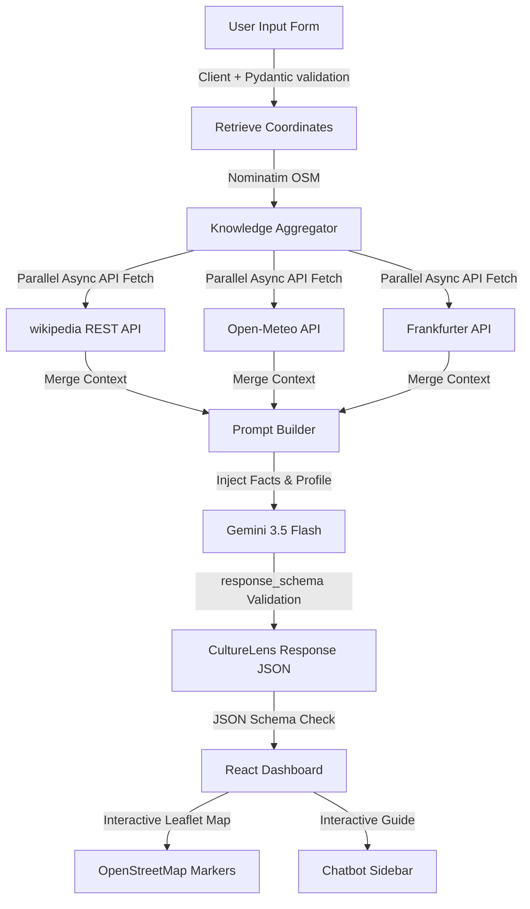

# CultureLens AI

> **"Discover destinations like a local, not a tourist."**

CultureLens AI is a production-grade, highly-optimized, and personalized Generative AI travel companion platform designed for Google's **PromptWars** Hackathon. It assists travelers in discovering authentic heritage sites, off-the-beaten-path hidden gems, and local dining traditions while creating customized daily itineraries, explaining folklore stories, and teaching local etiquette.

---

## 🌟 Submission Details

- **Chosen Vertical**: AI Travel Guide & Cultural Heritage Archivist
- **Core Logic & Approach**:
  1. **Input Validation**: Validates user preferences (destination, duration, style, interests, languages) on both the frontend and backend.
  2. **Factual Grounding**: Queries Nominatim OpenStreetMap API to resolve destination coordinates and country codes.
  3. **Concurrent Knowledge Aggregator**: Executes concurrent async HTTP fetches (using `asyncio.gather` and connection-pooled `httpx.AsyncClient`) to aggregate real-time weather (Open-Meteo), factual context (Wikipedia Summary API), local attractions (Wikipedia Search API), and exchange rates (Frankfurter API).
  4. **Strict JSON Schema Generation**: Configures Gemini 3.5 Flash using strict structured output constraints (`response_schema`), instructing it to build a detailed itinerary, phrasebook, and custom folklore guides using *only* the aggregated factual context.
  5. **Interactive Dashboard**: Dynamically renders Leaflet map markers, highlights local hidden gems, and opens a conversational tour companion sidebar.
- **Key Assumptions Made**:
  - The destination must be geocodable via OpenStreetMap Nominatim. If it is not, the API returns `422` with a clear message instead of guessing a location.
  - Exchange rates come from Frankfurter (ECB reference rates, ~30 currencies). If a rate is unavailable, the guide says so rather than inventing one. The same applies to weather.
  - The Gemini model is configured with a valid `GEMINI_API_KEY` (e.g. injected in the environment).

---

## 🏛️ System Architecture



---

## 📁 Folder Structure

```
PromptWar/
├── backend/
│   ├── app/
│   │   ├── clients/             # Factual API clients
│   │   │   ├── nominatim.py     # OSM Coordinates search
│   │   │   ├── wikipedia.py     # Heritage & summary text
│   │   │   ├── weather.py       # Open-Meteo climate stats
│   │   │   └── currency.py      # Frankfurter conversion rates
│   │   ├── prompts/
│   │   │   └── travel_prompt.py # Chat & guide prompts
│   │   ├── routers/
│   │   │   └── travel.py        # /generate & /chat routes
│   │   ├── schemas/
│   │   │   └── travel.py        # Pydantic response models
│   │   ├── services/
│   │   │   ├── gemini.py        # Gemini API client
│   │   │   └── orchestrator.py  # Concurrent orchestrator pipeline
│   │   ├── utils/
│   │   │   └── sanitization.py  # Text XSS & injection filters
│   │   ├── config.py            # CORS & server settings
│   │   └── main.py              # FastAPI app setup
│   ├── tests/                   # Pytest suite
│   ├── requirements.txt         # Pip requirements
│   └── render.yaml              # Render blueprint config
├── frontend/
│   ├── src/
│   │   ├── components/          # React layout widgets
│   │   │   ├── DiscoveryBoard.tsx # Sights, Food, and Safety Tabs
│   │   │   ├── ItineraryTimeline.tsx # Chronological itinerary with story mode
│   │   │   ├── InteractiveMap.tsx  # Leaflet OpenStreetMap markers
│   │   │   ├── InteractiveGuide.tsx # Chatbot local guide sidebar
│   │   │   ├── LoadingIndicator.tsx # Visual animated skeleton loader
│   │   │   └── ErrorMessage.tsx   # Access error boundaries
│   │   ├── types/
│   │   │   └── travel.ts        # TypeScript interface models
│   │   ├── services/
│   │   │   └── api.ts           # Fetch API hooks
│   │   ├── utils/
│   │   │   ├── safe.ts          # Safe URL + popup rendering for model output
│   │   │   └── validation.ts    # Frontend form validation
│   │   ├── App.tsx              # Main Dashboard frame
│   │   └── main.tsx             # DOM bootstrapper
│   ├── package.json             # NPM dependencies
│   ├── tailwind.config.js       # Tailwind CSS styles
│   └── vite.config.ts           # Bundler settings
└── README.md
```

---

## 🚀 Installation & Local Setup

### Prerequisite
Ensure Python 3.11+ and Node.js 18+ are installed.

### 1. Backend Setup
1. Navigate to the backend folder:
   ```bash
   cd backend
   ```
2. Install Python dependencies:
   ```bash
   pip install -r requirements.txt
   ```
3. Copy environment configuration:
   ```bash
   cp .env.example .env
    # Populate GEMINI_API_KEY="your-gemini-api-key" in .env
    # Optionally configure GEMINI_MODEL="models/gemini-1.5-flash" (defaults to models/gemini-3.5-flash)
    ```
4. Start development server:
   ```bash
   uvicorn app.main:app --reload
   ```
   The backend will run on `http://localhost:8000`.

### 2. Frontend Setup
1. Navigate to the frontend folder:
   ```bash
   cd ../frontend
   ```
2. Install dependencies:
   ```bash
   npm install
   ```
3. Start the Vite React server:
   ```bash
   npm run dev
   ```
   Open `http://localhost:5173` in your browser.

---

## 🧪 Testing

Both suites are hermetic: no Gemini key and no network access needed. CI runs them on every push and pull request (`.github/workflows/ci.yml`).

### Backend tests
```bash
cd backend
pip install -r requirements-dev.txt
pytest
```
Covers API clients (with a mocked HTTP transport), grounding rules, input bounds, CORS, body-size limit and rate limiting.

Manual smoke checks against a real key and running server live in `backend/scripts/`.

### Frontend tests
```bash
cd frontend
npm test
npm run build
```

---

## 🔒 Security Measures
* **Grounded output**: Coordinates, country, currency code and weather in the response come from the source APIs, overwriting whatever the model wrote. Generated attractions located outside the destination are discarded. Missing facts are reported as unavailable, never defaulted.
* **Input bounds**: Every request field has a length limit, lists are capped, and chat history is limited to the last 20 turns. Request bodies over 256 KB are rejected before parsing.
* **Prompt injection**: Not solvable with character filtering, so it is handled structurally: user text is fenced and labelled as data in prompts, chat roles are restricted to `user`/`assistant`, and the sanitizer only strips markup and control characters (real names like *Xi'an* and amounts like *₹50,000* survive).
* **Safe rendering**: Model output is never injected as HTML. Map popups are built as DOM text nodes, and links and images are only used if they are `https:` URLs.
* **CORS & abuse**: Explicit origin allow-list (a `*` value is ignored), no credentials, and per-IP rate limits on the Gemini-backed endpoints (`GENERATE_RATE_LIMIT`, `CHAT_RATE_LIMIT`). Limits are in-memory per process; use Redis storage when running multiple instances.
* **Information leakage**: Stack traces are logged server-side; clients receive generic error messages.

---

## ⚡ Performance Optimization
* **Parallel Client Calls**: Utilizes `asyncio.gather` to retrieve geo, weather, exchange rates, and wiki text in parallel, reducing fetch overhead.
* **API response_schema Validation**: Directs Gemini 3.5 Flash to return schema-compliant outputs using native JSON formats, reducing context token waste and parsing retry loops.
* **Token Budget Compression**: Condenses the generated itinerary into short structural summaries before passing context to the chat guide, optimizing prompt length and reducing chatbot response latencies.
